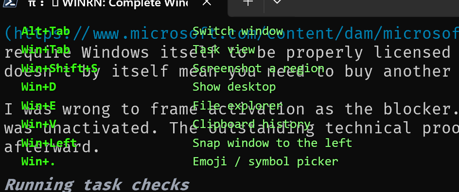

# ShortcutScout

A Windows overlay that watches which window has focus and shows keyboard shortcuts for *that* app — including shortcuts you probably don't know exist — on a click-through, always-on-top panel that moves out of your cursor's way and brightens when you step away.

See `SPEC.md` for the 13-point requirements this was built against.



## Behavior (all defaults)

| Behavior | Default |
|---|---|
| Toggle completely hidden | `Ctrl+Alt+S` (deliberately occasional — behavior is otherwise automatic) |
| Tune it | `Ctrl+Alt+O` or tray → **Settings…** — size, rows, timings, mode |
| Default visibility | **hidden** while you work — nothing sits in your field of view |
| On switching windows or apps | **peek**: full-strength, readable, for **6s**, then gone |
| During long stretches | shows again every **90s** (`re_peek_seconds`) so discovery actually happens |
| After **30s** with no input | `1.0`, neon at full strength, so it reads from across the room |
| Look | bare neon-green text with a dark halo — no card, no title bar, no border |
| Fade | in **200 ms**, out **180 ms** (leaving needs less attention than arriving) |
| Shortcut rotation | advances on every appearance, and steps to the next slice every `rotate_seconds` (4) while it is on screen |
| Cursor avoidance | jumps to the docked position **furthest** from the cursor, keeping **72 px** clear |
| Docking | 3×3 grid of edges/corners at a **20 px** inset, with **60 px** hysteresis so it never twitches |
| Detection | foreground window → process name, exe, and window title |
| Rows shown | up to 8, interleaving core and not-yet-seen `discovery` entries |

The toggle is not how the overlay normally appears — focus changes, idle, and rotation drive it. The hotkey exists only to get it out of the way.

## Stack

WPF / C# on .NET 8, with direct Win32 interop. Chosen after researching the alternatives: Electron is heavy and loses mouse events at higher integrity levels, Tauri's Windows alpha channel is explicitly ignored, and Python/tkinter only offers whole-window alpha with no per-pixel control.

The window is layered and non-activating:

```
WS_EX_LAYERED | WS_EX_TRANSPARENT | WS_EX_TOPMOST | WS_EX_NOACTIVATE | WS_EX_TOOLWINDOW
```

Verified on the running process: `exstyle=0x080800A8`, all five flags set, `visible=True`. Transparency and click-through are separate Win32 concerns — a transparent window still eats clicks unless `WS_EX_TRANSPARENT` is also applied.

## Why it isn't a semi-transparent panel anymore

The first versions parked the overlay at a fixed low opacity so you could "see through" it. That was measurably the worst option available, and the research explains why:

- **There is a documented dead zone.** Harrison et al. (CHI'95, *Transparent Layered User Interfaces*) found legibility collapses below ~10–20% visibility, while a persistent translucent layer still interferes with focused reading. Below the legibility floor a panel is **unreadable but still in the way** — exactly the failure mode reported here.
- **The scrim maths rules out "a bit transparent".** White body text needs a black scrim of **~0.54** to hold 4.5:1 against a worst-case white backdrop (0.54 → ~4.6:1). Anything below that cannot be legible over arbitrary content, no matter how nice it looks.
- **No shipped shortcut overlay does this.** PowerToys Shortcut Guide defaults to **90%** background opacity; macOS CheatSheet and the iPad ⌘-hold overlay are **hold-to-show, release-to-hide**. None leaves a permanent faint panel on screen.
- **Persistence, not transparency, is the problem.** Ambient-display guidance (Pousman & Stasko; Mankoff et al.) puts peripheral widgets at the *change-blind* / *make-aware* levels, shown on a state change rather than permanently; calm-technology guidance is "appear, then recede".

So the overlay now has **two modes**, and neither can produce a half-visible smudge. A test asserts that for every mode, idle value and peek state, opacity is either `0` or at least `ReadableFloor`.

### `peek` (default)
Hidden while you work. Switching to a configured app shows its shortcuts at full strength for 6 seconds — that's the discovery moment, and it doesn't need a permanent panel to happen. Idle for 30s and it stays up, bright, until you return. This is the calm-technology model: appear on a change, then recede.

### `ambient`
Always present, but at **0.90** and genuinely readable — the PowerToys model, for when you want a constant reference. It refuses to go below `ReadableFloor`, so it can't drift back into the unreadable middle.

Both modes also stop the panel **moving while it is visible**. Motion onset is the most attention-capturing change a peripheral widget can make, so dodging the cursor now happens only while it's invisible: it simply never appears under the pointer.

## Floating text, not a panel

There is no card, header, footer, separator or border. The overlay is green Consolas text
floating directly on the desktop, so there is no rectangle to be "in the way" — you see
shortcuts, not chrome.

That means contrast has to come from the text itself. A dark halo behind neon glyphs does
the job: neon `#39FF14` against a black halo measures **15.5:1**, comfortably past WCAG AAA.

A halo is also the only thing that survives a light background. Neon green on a white page is
**1.35:1** — invisible — so the halo, not the desktop, is what the text is actually measured
against. The sampler keeps checking what's behind the panel every ~2 seconds (outside its own
rectangle, never the interior, which would measure itself) and thickens the halo over busy
content so letterform edges don't dissolve into text or imagery behind them:

| Backdrop (luminance spread) | Halo blur |
|---|---|
| Flat (`< 14`) | `4.0` |
| Mixed | `5.0` |
| Busy (`>= 26`) | `6.5` |

Sampling runs off the UI thread — grabbing a few hundred thousand pixels on the dispatcher
made the overlay visibly stutter.

## Settings

The overlay is click-through and never takes focus, so it can't host its own controls.
**Ctrl+Alt+O** (or the tray menu) opens a normal window with sliders for text size, width,
rows shown, peek length, re-show interval, idle threshold, mode and ambient opacity. Changes
apply as you drag and are debounced into `config/shortcuts.json`.

Every knob, plus the ones worth adding, is listed in [`docs/CONFIG.md`](docs/CONFIG.md);
[`docs/README.md`](docs/README.md) says which document is authoritative for what.

## Where it goes

The panel relocates **only while it is invisible**, because motion onset is the most
attention-capturing thing a peripheral widget can do. Dodging while unseen means it simply
never appears under the pointer.

It picks the docked slot **furthest from the cursor**, not the nearest free one. The nearest
escape is a trap: it anchors the panel to whichever corner it started in, so it hops up and
down one edge forever and sits permanently in the way of whatever you're reading there.
Jumping to the far side uses the whole screen. A **60 px** hysteresis band stops it twitching
when the cursor sits on a boundary, and it stays put entirely when nothing is covering it.

`--sample <x> <y> <w> <h>` runs the sampler against any screen rectangle without the overlay, for checking what it sees:

`--sample <x> <y> <w> <h>` runs the sampler against any screen rectangle without the overlay, for checking what it sees:

```powershell
dotnet run --project src/ShortcutScout -- --sample 300 700 900 300
```

## Run

```powershell
winget install Microsoft.DotNet.SDK.8   # this machine had only the runtime
dotnet build ShortcutScout.sln -c Release
dotnet run --project src/ShortcutScout              # overlay + tray + hotkey
dotnet run --project src/ShortcutScout -- --cli list
```

Tray icon: Hide/Show, Reload config, Exit.

## Configuration

Human-editable JSON. `config/shortcuts.json` holds the global fallback; `config/apps/*.json` holds one file per app.

```json
{
  "id": "chatgpt",
  "name": "ChatGPT",
  "priority": 1000,
  "process_names": [],
  "title_contains": ["chatgpt.com", "ChatGPT"],
  "shortcuts": [
    { "keys": "Ctrl+Enter", "action": "Send message", "discovery": false },
    { "keys": "Ctrl+Shift+M", "action": "Switch model", "discovery": true }
  ]
}
```

`discovery: true` marks the lesser-known shortcuts that rotation surfaces over time.

**Why `priority` and title matching exist:** Devin and ChatGPT run inside Chrome, so the process name is always `chrome`. Their only reliable signal is the window title, and Chrome's own config also matches `"… - Google Chrome"`. A title match beats a process match, and `priority` breaks the remaining tie. Because priority dominates, these configs deliberately leave `process_names` empty — otherwise high priority plus `"chrome"` would hijack every browser window. There's a regression test for exactly that.

Shipped configs: Devin, ChatGPT, Zellij, Claude Code, Chrome, and a global fallback.

## Agent integration

MCP over stdio (JSON-RPC 2.0):

```powershell
dotnet run --project src/ShortcutScout -- --mcp
```

Tools: `list_apps`, `list_shortcuts {app}`, `add_shortcut {app,keys,action,discovery?,category?}`, `remove_shortcut {app,keys}`, `reload_config`.

```json
{ "mcpServers": { "shortcutscout": {
  "command": "dotnet",
  "args": ["run","--project","src/ShortcutScout","--","--mcp"] } } }
```

CLI equivalent: `--cli list | show <app> | add <app> <keys> <action> | remove <app> <keys>`.

## Tests

```powershell
dotnet test ShortcutScout.sln
```

**118 passing**, one file per concern under `tests/ShortcutScout.Tests/`, run on every PR by `.github/workflows/ci.yml` (Release build + tests on `windows-latest`). Covers config robustness (a broken file is skipped and named, an edit survives a reload wherever the app was defined, ids that are not plain file names are refused), MCP protocol conformance (no reply to notifications, JSON-RPC error codes, object schemas), log rotation, the rows staying put within one appearance, foreground matching (including Devin/ChatGPT inside Chrome and the browser-hijack regression), priority ordering, config load/save/skip-malformed, the 30s idle boundary, toggle, rotation stability and per-appearance advancement, reveal triggers and their rate limit, the persisted overlay settings round-trip, MCP round-trips through disk, cursor-avoidance geometry — including a sweep of every 40px position across a 1920×1040 work area asserting the panel never lands under the cursor — and the visible-time rotation rules.

## Verification tooling

`tools/` holds the scripts used to check this against the real desktop rather than trusting the build:

- `window_state.ps1` — lists every top-level window the process owns, including hidden ones (how "it isn't running" was diagnosed: the window existed, `visible=False`)
- `capture_window.ps1` — DPI-aware capture of one window by title substring (`-BringToFront` to defeat occlusion)
- `verify_placement.ps1` — sweeps the cursor across the screen and records where the panel lands after each move
- `verify_runaway.ps1` — records the window rect, moves the real cursor into the panel, waits for ticks, re-reads the rect
- `measure_idle.ps1` — injects input, captures the active state, waits out 30s, captures the idle state

These three **move the real mouse pointer**, so each refuses to run without `-AllowCursorControl` (exit 2). Run them in a disposable VM — on a working desktop they take over the cursor. Normal verification does not need them: the geometry sweep is a unit test, and the trace logs cursor and placement every tick if you want to check the dodge against a cursor you moved yourself.
- `measure_contrast.ps1` — samples luminance inside vs outside the panel
- `capture_overlay.ps1` — DPI-aware crop of just the overlay
- `capture_screen.ps1` — full desktop for diagnosing placement

### Logs

**Event log — always on.** `%LOCALAPPDATA%\ShortcutScout\logs\shortcutscout.log` (tray menu → *Open log folder*). A few lines per session plus one per reveal: startup (version, config folder, app count), every reveal with its reason (`window change` / `app change` / `re-peek` / `idle` / `ambient`), hide/show, config files that failed to parse, a hotkey another program already owns, and any unhandled exception with its stack. Capped at 1 MB with one backup (`.log.1`). This is the file to read when the panel "never appears" or the app is simply gone.

```
2026-11-27 00:22:30.138 INFO  starting v1.0.0.0 pid=3340 config='…\config' apps=6 mode=peek trace=off
2026-11-27 00:22:30.535 WARN  could not register Ctrl+Alt+S and Ctrl+Alt+O: already in use by another program
2026-11-27 00:22:30.542 INFO  reveal: window change app='chrome' slot=1 for 6s
```

**Trace — opt in.** Set `SHORTCUTSCOUT_TRACE=1` to also log cursor/placement/idle/opacity on every tick to `%TEMP%\shortcutscout-trace.log` (capped at 20 MB with one backup; event-log lines are mirrored into it). Stalls are logged as `STALL tick gap ...ms`, which is how the sampling stutter was found and fixed.

**When something throws.** An exception on the UI thread is logged and the overlay keeps running; five within a minute means it is not transient, so the app logs that, shows a tray balloon pointing at the log, and exits. Only one overlay runs per session — a second copy logs that and exits instead of drawing a second panel and fighting over the hotkeys.

Set `SHORTCUTSCOUT_FORCE_IDLE=1` to make the idle appearance reproducible — any real mouse movement resets the Windows idle timer, so this is the only reliable way to screenshot or tune the bright state.

## What was actually measured

- `dotnet build -c Release`: 0 errors, 0 warnings. `dotnet test`: **118/118**.
- Window styles on the live process: `0x080800A8` — layered, transparent, topmost, no-activate, tool-window.
- Run-away: with the panel docked right at `(960,646)`, moving the cursor to the right side sent it to `(20,20)` — it crosses the screen rather than shuffling along one edge.
- Idle: trace shows `idle=31s opacity=1.00` and `idle=0s opacity=0.92`, i.e. the 30s threshold drives it.
- Both states inspected visually; the screenshots above are the real rendered overlay.

## Limitations

- **Text without a backing plate is at the mercy of what's behind it.** A halo separates glyphs from their immediate surroundings, but a busy region with strong edges can still compete with thin strokes. A real blur (acrylic) scrim would remove that entirely, at the cost of bringing back the rectangle this design deliberately dropped.
- The halo reacts within ~2 seconds of a change, so a fast scroll to a very different background is briefly mismatched.
- The adaptation samples a ring around the panel, so it reads the backdrop's *neighbourhood* rather than the exact pixels it covers — close, but not identical under the panel itself.
- Neon text on a white page relies entirely on the halo for definition: the glyph fill itself is only ~1.35:1 against white, so a large white area directly behind the text is the least flattering backdrop it has.
- In `peek` mode you only see shortcuts for 6 seconds after switching apps. If that turns out too brief while reading a long list, raise `peek_seconds`.
- The research found no controlled study measuring attention theft from a persistent semi-transparent desktop widget, so the mode defaults are reasoned from the transparency-legibility, ambient-display and interruption-cost literature rather than measured on this app.
- Cursor avoidance clamps to the primary monitor's work area only.
- Devin/ChatGPT detection depends on the window title still containing their domain; a site rename breaks it until `title_contains` is updated.
- The overlay never takes focus, so it has no interactive controls — editing is via config files, the CLI, or MCP by design.
- Shortcut content for each app is hand-curated starter data, not scraped or verified against each app's current release.
